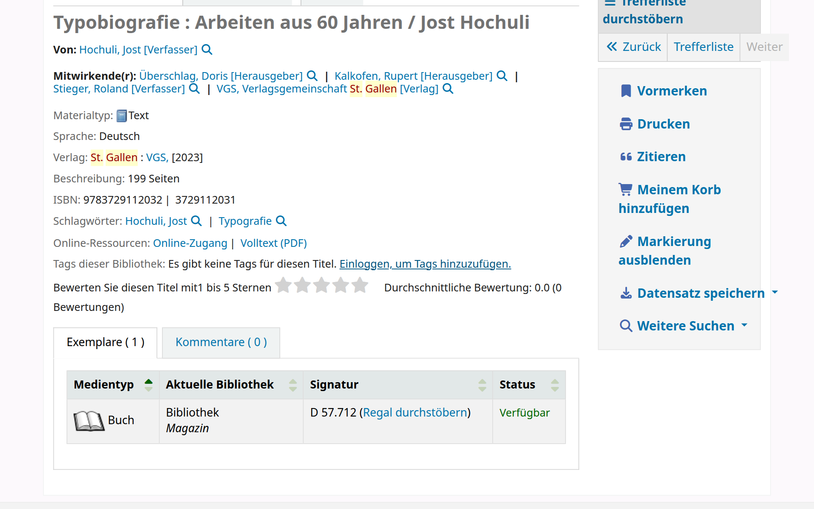
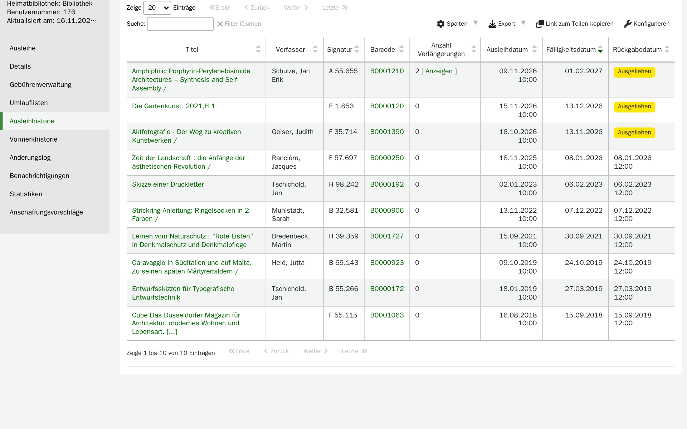
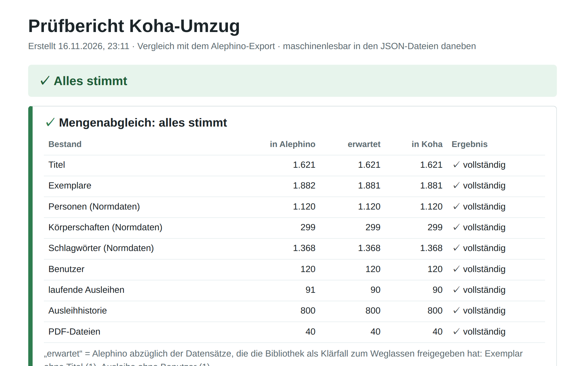
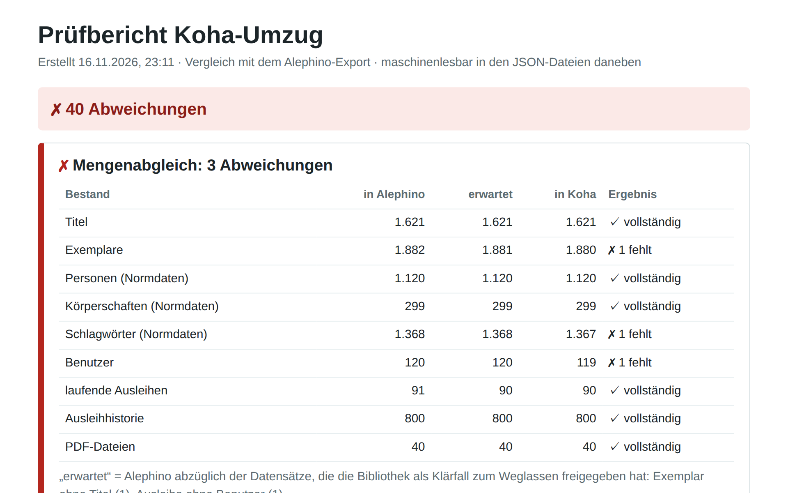

# koha-umzug

**Bibliotheken ziehen geprüft zu Koha um. koha-umzug bringt den Bestand aus Alephino in Koha, die freie
Bibliothekssoftware: Titel, Exemplare, Normdaten, Benutzer, Ausleihen und PDF-Dateien. Danach vergleichen vier
Prüfwerkzeuge jeden Datensatz mit dem alten Bestand, und sie bleiben bei der Bibliothek. Freie Software, die heute
läuft: gemessen in der Testumgebung an einem Beispielbestand in Koha 26.05.**


<sub>Rundgang: 78 Sekunden, sechs Szenen, ohne Ton; aufgenommen am 16.11.2026 in der Testumgebung des Messlaufs.
Bewegtes Bild oben: 4,3 MB.
[Video herunterladen (MP4, 3,2 MB)](https://github.com/panoherbe/koha-umzug/raw/main/medien/rundgang.mp4)
· Text des Rundgangs weiter unten.</sub>

**Für wen:** Bibliotheken, die von Alephino zu Koha wechseln möchten, gerade kleinere und Spezialbibliotheken ohne
eigene IT-Abteilung, und alle, die sie dabei begleiten. Andere Systeme, die MAB2 oder MARC21 ausgeben, passen mit
einer eigenen Feldzuordnung ebenso.

<p align="center">
  
  
  
  
</p>

<sub>Bilder aus dem Rundgang vom 16.11.2026: ein Titel, die Ausleihhistorie, der Prüfbericht nach dem Umzug und nach
der Fehlerprobe.</sub>

## Was nach dem Umzug stimmt

Kurz: Jede Zeile ist gebaut und gemessen. Die Zahlen stammen aus dem Messlauf vom 16.11.2026 auf Commit `81b7e5f`,
gemessen in der Testumgebung ([Messprotokoll](nachweis/2026-11-16/PROTOKOLL.md), Rohdaten
[`ergebnisse.json`](nachweis/2026-11-16/ergebnisse.json)). Die Katalog- und Normdaten sind echt (Deutsche
Nationalbibliothek, CC0); Exemplare, Benutzer, Ausleihen und PDF-Dateien sind **simuliert**.

| Was Sie erwarten | So macht es koha-umzug | Gemessen am 16.11.2026 |
|---|---|---|
| Der ganze Bestand kommt an | liest den Alephino-Export: Titel und Normdaten im Format MAB2 (Zeilenformat „Aleph sequential“), Exemplare, Benutzer und Ausleihen als Tabellen | 1.621 Titel, 1.882 Exemplare, 2.787 Normsätze, 120 Benutzer, 91 laufende Ausleihen, 800 zurückgegebene, 40 PDF-Dateien |
| Umlaute bleiben Umlaute | schreibt MARC21 im Zeichensatz UTF-8 und setzt zerlegte Zeichen zusammen, damit die Suche „Müller“ auch findet | 4.272 Werte vereinheitlicht |
| Jede alte Nummer bleibt auffindbar | die Alephino-Nummer steht im Datensatz; je Bestand eine Tabelle „alte Nummer → Koha-Nummer“ | 4 Tabellen, je Datensatz eine Zeile |
| Personen und Schlagwörter sind verknüpft | Personen, Körperschaften und Schlagwörter werden Normsätze in Koha; jede Verknüpfung über die Nummer, nie über den Namen geraten | 6.388 Verknüpfungen, 0 ohne Normsatz |
| Vom Heft zur Zeitschrift | jedes Heft und jeder Band zeigt „In: …“ mit einem Link zur Zeitschrift oder Reihe | 234 Hefte und Bände |
| Ausleihen laufen weiter | Benutzer mit Ausweisnummer; laufende Ausleihen mit Frist und Zahl der Verlängerungen; die Historie mit Ausleih- und Rückgabedatum in der Dienstoberfläche | 120 Benutzer, 90 laufende Ausleihen, 800 in der Historie |
| PDF-Dateien hängen am Titel | als Koha-Upload, Byte für Byte unverändert; öffentlich oder nur für das Personal | 40 Dateien, 30 öffentlich, 10 intern; Prüfsummen gleich |
| Nichts verschwindet still | jeder Datenfehler wird ein Klärfall; erst wenn die Bibliothek entschieden hat ([Entscheidungen](beispiel/freigaben.json)), wird geladen | 6 Arten von Datenfehlern eingebaut (simuliert), alle gemeldet |
| Laden mit Koha-eigenen Werkzeugen | `bulkmarcimport.pl` und `import_patrons.pl`; Ausleihen und die Einträge der PDF-Dateien per SQL; danach der Suchindex | alles zusammen in 76,2 s |
| Belegt, dass alles stimmt | vier Prüfwerkzeuge (unten), ein Bericht zum Lesen und einer für Programme | 0 Abweichungen, geprüft in 4,7 s |
| Die Prüfung ist selbst geprüft | Fehlerprobe: Koha absichtlich an 14 Stellen beschädigt, jede Stelle anders | 14 von 14 gefunden (simuliert), dazu 26 Folgemeldungen |
| Wiederholbar | automatische Tests ohne Koha; der ganze Messlauf mit einem Befehl | 25 von 25 Tests bestanden |

## Die vier Prüfwerkzeuge

Kurz: Sie vergleichen Koha mit dem Alephino-Export und listen jede Abweichung. Sie ändern nichts in Koha und brauchen
nur Python 3.10 oder neuer ohne Zusatzpakete. Das ist auf üblichen Debian- und Ubuntu-Servern installiert (Debian 12:
Python 3.11, Ubuntu 24.04: Python 3.12), sonst genügt `apt install python3`.

| Werkzeug | Was es prüft | Was es ausgibt |
|---|---|---|
| `mengen` | je Bestand: wie viele in Alephino, wie viele nach den Entscheidungen der Bibliothek zu erwarten sind, wie viele in Koha; dazu jede fehlende und jede zusätzliche Nummer | `mengen.json` |
| `beziehungen` | jedes Exemplar am richtigen Titel mit Barcode, Signatur und Ausleihstatus; jede Verknüpfung zum richtigen Normsatz; jedes Heft an seiner Zeitschrift; jeder Titel Zeichen für Zeichen (findet kaputte Umlaute) | `beziehungen.json` |
| `pdf` | jede PDF-Datei am Titel: öffentlich abrufbar und unverändert (SHA-256); interne Dateien ohne Anmeldung **nicht** abrufbar, mit Anmeldung schon | `pdf.json` |
| `ausleihen` | jede laufende Ausleihe: wer, welches Exemplar, seit wann, bis wann, wie oft verlängert; die Historie vollständig | `ausleihen.json` |

Alle vier schreiben zusammen `abweichungen.csv` und `bericht.html`
([Bericht nach dem Umzug](nachweis/2026-11-16/pruefbericht/bericht.html),
[Bericht nach der Fehlerprobe](nachweis/2026-11-16/fehlerprobe-bericht/bericht.html); auf GitHub über „Raw“ als Datei
laden und im Browser öffnen). Rückgabewert 0 heißt: keine Abweichung. So laufen sie auch nach dem Umzug, zum Beispiel
nach jedem Koha-Update.

Gelernt beim Messen: Koha antwortet auf den Abruf einer fehlenden Datei mit HTTP 200 und einer Hinweisseite. Das
Werkzeug prüft deshalb den Inhalt (beginnt er mit `%PDF`, stimmt die Prüfsumme), nicht nur die Antwort des Servers.

## In zwei Minuten selbst prüfen

Kurz: Umwandlung und Tests laufen ohne Koha; für den ganzen Weg startet ein Skript Koha 26.05 auf Ihrem Rechner.

Ohne Koha (Python 3.10 oder neuer):

```bash
git clone https://github.com/panoherbe/koha-umzug.git && cd koha-umzug
pip install pymarc pytest
python daten/nachbilden.py                     # baut den Beispiel-Export (wenige Sekunden)
python -m umzug umwandeln beispiel/export beispiel/koha --freigaben beispiel/freigaben.json
python -m pytest -q                             # 25 Tests
```

`beispiel/koha/klaerfaelle.csv` zeigt danach jeden Datenfehler mit der Entscheidung aus `freigaben.json`. Ohne
`--freigaben` hält die Umwandlung an und listet, was zu entscheiden ist.

Mit Koha 26.05 (Docker; Platz: Koha-Image 5,2 GB, Koha-Quellcode 1,0 GB; Arbeitsspeicher im Betrieb
≈ 2,3 GB. Gemessen am 16.11.2026: Start in 108 Sekunden, als das Image schon geladen war; beim ersten
Mal kommt der Download dazu):

```bash
koha/testumgebung.sh ~/koha-test                # offizieller Entwicklungs-Container der Koha-Gemeinschaft
python -m umzug laden beispiel/koha beispiel/export --container kohaumzug-koha-1 --leeren --sprache de-DE
python -m umzug pruefen alle beispiel/export beispiel/koha --container kohaumzug-koha-1 \
  --dienst-benutzer koha --dienst-passwort koha
```

Dann den Katalog unter http://127.0.0.1:18080 ansehen, die Dienstoberfläche unter http://127.0.0.1:18081 (Konto
`koha`, Passwort `koha`, nur in dieser Testumgebung). `--leeren` löscht vorher alle Titel, Exemplare, Benutzer und
Ausleihen und läuft deshalb nur zusammen mit `--container`. Den ganzen Messlauf wiederholen:
`nachweis/messlauf.sh kohaumzug-koha-1`.

## Was Sie heute schon prüfen können

Kurz: Feldzuordnung, Klärfälle, Messung und Prüfbericht liegen offen.

- **Die Feldzuordnung** steht als Tabelle in [`zuordnung/FELDZUORDNUNG.md`](zuordnung/FELDZUORDNUNG.md): je MAB2-Feld
  das MARC21-Feld und seine Bedeutung. Ein Test hält sie gleich mit dem Code.
- **Der Umgang mit Datenfehlern** steht in [`beispiel/freigaben.json`](beispiel/freigaben.json) und im
  [Messprotokoll](nachweis/2026-11-16/PROTOKOLL.md): doppelter Barcode, Exemplar ohne Titel, Ausleihe ohne Benutzer,
  Verknüpfung ins Leere, Feld ohne Zuordnung, unbekanntes Zugangsdatum.
- **Die Messung ist wiederholbar:** ein Befehl lädt, prüft, beschädigt Koha absichtlich, prüft wieder, lädt neu und
  schreibt das Protokoll; jede Zahl darin kommt aus den Dateien des Laufs.

## Text des Rundgangs

<details>
<summary>Die Sätze im Video (aufklappen)</summary>

Sechs Szenen. Oben rechts steht die ganze Zeit: github.com/panoherbe/koha-umzug. Die beiden Ausleihtabellen zeigen
im Video weniger Spalten als Koha von sich aus (Tabelleneinstellungen der Dienstoberfläche), damit sie ins Bild passen.

| ab | Satz (klein darunter) | Was man sieht |
|---|---|---|
| 0:00 | Der Umzug nach Koha, Satz für Satz geprüft. *(Titel, Exemplare, Normdaten, Ausleihen und PDF-Dateien. Die Prüfwerkzeuge bleiben bei der Bibliothek.)* | Titelkarte |
| 0:06 | Nach dem Umzug: der Katalog in Koha 26.05. *(Katalogdaten der Deutschen Nationalbibliothek; Exemplare und Benutzer simuliert.)* | der Katalog; Suche nach „St. Gallen“, zwei Treffer, „Typobiografie“ wird geöffnet |
| 0:18 | Jeder Titel mit Exemplaren, Normdaten und PDF. *(Signatur und Standort wie vorher; die PDF hängt am Titel.)* | der Titel mit Verfasser und Herausgebern (Rollen auf Deutsch), Schlagwörtern und dem Exemplar mit Standort und Signatur; „Volltext (PDF)“ hervorgehoben |
| 0:27 | Hefte bleiben mit ihrer Zeitschrift verbunden. *(Ein Klick führt vom Heft zur Zeitschrift.)* | das Heft „Dem Licht gewidmet“ mit „In: Monumente“, ein Klick, die Zeitschrift |
| 0:34 | Wer was ausgeliehen hat, und bis wann. *(Die laufenden Ausleihen einer Benutzerin in der Dienstoberfläche.)* | Dienstoberfläche: die laufenden Ausleihen einer Benutzerin mit Fälligkeit |
| 0:40 | Auch die Historie kommt mit. *(Zurückgegebene Ausleihen mit Ausleih- und Rückgabedatum.)* | ihre Ausleihhistorie: laufende und zurückgegebene Ausleihen mit Rückgabedatum |
| 0:45 | Das Prüfwerkzeug vergleicht jeden Datensatz. *(Mengen, Verknüpfungen, PDF-Dateien und Ausleihen, gegen den Alephino-Export.)* | Prüfbericht nach dem Umzug: „Alles stimmt“ |
| 0:52 | Zur Probe 14 Fehler eingebaut: alle gefunden. *(Simuliert: absichtlich beschädigt, um die Werkzeuge selbst zu prüfen.)* | Prüfbericht nach der Fehlerprobe, rot markiert |
| 1:02 | Gemessen am 16.11.2026 | 1.621 Titel; 76,2 s Laden; 0 Abweichungen, geprüft in 4,7 s; 14 von 14 Fehlern gefunden (simuliert) |
| 1:10 | Selbst prüfen | github.com/panoherbe/koha-umzug; Lizenzen und Herkunft der Daten; Panagiotis Herbe |

</details>

## Was der Prototyp noch nicht ist

Kurz: ein laufender, gemessener Anfang mit Beispieldaten; für Ihren Bestand kommen Ihre Felder und Ihre Entscheidungen
dazu.

- **Beispieldaten, keine echte Alephino-Installation.** Der Export ist nachgebildet: echte Katalogdaten der Deutschen
  Nationalbibliothek, umgesetzt in MAB2 im Zeilenformat von Alephino; Exemplare, Benutzer, Ausleihen und PDF-Dateien
  sind simuliert. Ein echter Export hat eigene Felder, Codes und Sonderfälle; die Feldzuordnung wird daran angepasst.
- **Ein kleiner Bestand.** 1.621 Titel. Die Prüfwerkzeuge lesen je Tabelle mit einer Abfrage; wie lange Laden und
  Prüfen bei einem großen Bestand dauern, ist nicht gemessen.
- **Nur in der Testumgebung gemessen.** Für einen Koha-Server gibt es die Aufrufe über `koha-mysql` und `koha-shell`
  (`--sql`, `--shell`); dort ist noch nichts gemessen, und Pfade und Rechte unterscheiden sich je Installation.
- **Ausleihen kommen per SQL** in Koha, ebenso die Einträge der PDF-Dateien; so bleiben Ausleih- und Rückgabedatum aus
  Alephino erhalten. Ob sich ein übernommenes Exemplar danach in Koha zurückbuchen und verlängern lässt, prüft noch
  kein automatischer Test.
- **Passwörter** kommen nicht mit. Benutzerinnen und Benutzer vergeben sie über „Passwort vergessen“ neu.
- **Ausleihhistorie und alle Benutzerkonten** wandern heute immer mit.
- **Suchindex:** gemessen mit Zebra, dem Standard der Testumgebung; Elasticsearch ist noch nicht geprüft.

## Wie es weitergeht

Kurz: Geplant, noch nicht gebaut. Ziel ist, dass eine Bibliothek ohne IT-Abteilung ihren Umzug selbst vorbereiten und
prüfen kann.

- Die Feldzuordnung als Tabelle statt Code, mit Vorlagen je Altsystem und Beispielen aus den eigenen Daten.
- Weitere Quellen: MARC21- und MARCXML-Exporte anderer Systeme und Bestandslisten als Tabelle.
- Ein Umzugsassistent im Browser, der bei der Bibliothek läuft: Export ablegen, Klärfälle entscheiden, Probelauf,
  Prüfbericht; ohne Kommandozeile.
- Die wichtigsten Abgleiche als Koha-Plugin in der Dienstoberfläche, auch für spätere Updates; Koha-Server und
  Elasticsearch, nicht nur die Testumgebung.
- Datensparsam: Ausleihhistorie und alte Benutzerkonten wandern nur mit, wenn die Bibliothek es ausdrücklich entscheidet.

**Mitmachen:** Probieren Sie den Weg mit dem Beispielbestand aus. Rückmeldungen, Fragen und Felder Ihres Exports, die
hier noch fehlen, gern als Issue auf GitHub oder über [panoherbe.com](https://www.panoherbe.com). Bitte keine echten
Benutzerdaten hochladen.

## Kontakt

[panoherbe.com](https://www.panoherbe.com) · Panagiotis Herbe

---

## Für Ihre IT

Kurz: Python 3, eine Bibliothek für MARC (pymarc) und die Werkzeuge von Koha, alles freie Software.

| | |
|---|---|
| Umwandlung | `umzug/umwandeln.py`, `umzug/mab2marc.py`: Python 3.10+, pymarc; schreibt MARC21 (UTF-8, NFC), CSV und JSON |
| Laden | `umzug/laden.py`: `bulkmarcimport.pl` und `import_patrons.pl` über `koha-shell`; laufende Ausleihen, Historie und die Einträge der PDF-Uploads per SQL über `koha-mysql`, die PDF-Dateien selbst in den Upload-Ordner; verweigert das Laden bei offenen Klärfällen; gemessen in der Testumgebung (Container) |
| Prüfen | `umzug/pruefen/`: nur Python-Standardbibliothek; liest Koha über `koha-mysql` (nur lesen) und über HTTP |
| Fehlerprobe | `umzug/fehlerprobe.py`: nur für Testumgebungen, ändert Daten |
| Testumgebung | `koha/testumgebung.sh`: koha-testing-docker der Koha-Gemeinschaft (Commit `ef7f1f9`, Image 26.05), Koha `v26.05.05-1`, Ports nur auf 127.0.0.1 |
| Tests | `python -m pytest -q`; GitHub Actions bei jedem Push mit Python 3.10 und 3.12 |
| Daten | `daten/dnb/`: Titel- und Normdaten der Deutschen Nationalbibliothek, geholt mit `daten/holen.py`; `daten/nachbilden.py` baut daraus den Export, gleiche Eingabe ergibt gleiche Bytes |

Befehle:

```text
python -m umzug umwandeln <export> <ziel> --freigaben <datei>
python -m umzug laden <ziel> <export> (--container NAME | --sql "sudo koha-mysql INSTANZ" --shell "sudo koha-shell INSTANZ -c")
python -m umzug pruefen <mengen|beziehungen|pdf|ausleihen|alle> <export> <ziel> [Koha-Zugang] [--bericht ORDNER]
python -m umzug zuordnung
```

## Daten und Lizenzen

- **Code:** [GNU Affero General Public License 3.0](LICENSE) (AGPL-3.0-only), seit dem ersten Commit.
- **Katalog- und Normdaten** in `daten/dnb/`: Deutsche Nationalbibliothek, [CC0 1.0](https://creativecommons.org/publicdomain/zero/1.0/).
  Auswahl über Schlagwörter zu Kunstgeschichte, Architektur, Denkmalpflege, Malerei, Typografie, Gartenkunst,
  Fotografie und Design; von den Normsätzen nur Namen, Namensformen, Lebensdaten und Kennungen.
- **Simuliert:** Alephino-Nummern und die MAB2-Form der Datensätze, Exemplare, Benutzer (erfundene Namen, Adressen
  @example.org), Ausleihen, PDF-Dateien und die eingebauten Datenfehler.
- **Koha:** Koha-Gemeinschaft, GPL-3.0-or-later. **koha-testing-docker:** Koha-Gemeinschaft, GPL-3.0. Beide werden
  von `koha/testumgebung.sh` geholt und sind nicht Teil dieses Repositorys.
